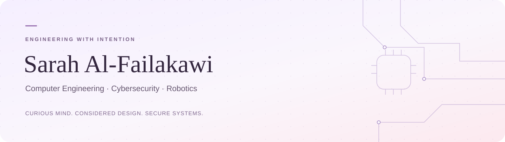

**Learning &nbsp; / &nbsp; building &nbsp; / &nbsp; exploring**

Exploring AI agents, cybersecurity, and robotics through hands-on projects.

[Explore MIZAN AI ↗](https://mizan-venture-path.base44.app/)

 

### 01 / A little about me

I’m Sarah, exploring the intersection of **computer engineering**, **cybersecurity**, and **robotics**. I’m currently learning about AI agents and their security through hands-on projects, including **AgentShield**.

My academic focus includes **MSc Cybersecurity**. AgentShield is a learning project where I’m exploring tool permissions, policy checks, and audit records using synthetic scenarios.

I’m building my skills one project at a time, testing ideas and documenting what I learn.

 

### 02 / Selected work

| Project | What I’m building | Status |
| :--- | :--- | :--- |
| **AgentShield** | A synthetic AI-agent security lab with independent tool authorization and persisted audit records. | **Local MVP** · Lab + Guard implemented; full Monitor planned |
| **[SYNAPSE ↗](https://synapse.malyapp.workers.dev/)** | An interactive neuroscience explorer with MRI-derived 3D anatomy and educational lessons. | **Deployed educational prototype** · source currently local |
| **[MALY · مالي ↗](https://maly.malyapp.workers.dev/)** | A bilingual personal-finance app for transactions, budgets, and savings goals. | **Published web app** · authentication workflows not independently verified |
| **[MIZAN AI ↗](https://mizan-venture-path.base44.app/)** | Startup decision support exploring founder fit, financial readiness, and market potential. | **Published web app** · public landing page verified |

AgentShield uses synthetic scenarios. SYNAPSE is educational, not diagnostic. MIZAN’s assessment and AI consultation workflows have not been independently tested.

 

### 03 / In my workspace

**Using in my projects**  
Python · TypeScript · React · FastAPI · SQLite

**Learning about**  
AI-agent security · Least privilege · Human-centered interfaces · Interactive learning

**Exploring**  
Robotics · The connection between software and physical systems

 

---

Learning by building, testing, and asking questions.

